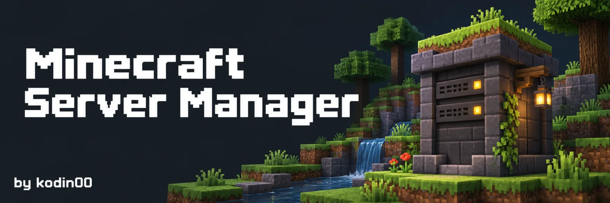

# Mineserver Panel

Run and manage multiple Minecraft Java servers from one web panel. Create servers, view logs, run console commands, install mods or plugins, and make backups—all from your browser.

Try the [interactive demo](https://kodin00.github.io/mineserver/). Switch between admin and player to explore the panel and mod request workflow. The demo runs entirely in your browser with sample data; it cannot create or connect to real servers.

## Quick start

Requires a Linux machine with [Docker Engine](https://docs.docker.com/engine/install/), Docker Compose v2, and `curl`.

```sh
curl -fsSL https://raw.githubusercontent.com/kodin00/mineserver/master/install.sh | sh
```

This creates a `mineserver` folder, pulls the images from GHCR, and starts the panel. The installer generates a random `ADMIN_PASSWORD` and saves it in `mineserver/.env`; use that password to sign in at `http://localhost:8080`. To use a different password, set `ADMIN_PASSWORD` in `mineserver/.env` before the first start.

Worlds, backups, and panel data are saved in `/opt/mineserver`, so they survive container restarts and updates.

### Without the install script

Uses the same published GHCR images, no local build needed:

```sh
mkdir mineserver && cd mineserver
curl -fsSLO https://raw.githubusercontent.com/kodin00/mineserver/master/compose.yaml
curl -fsSLO https://raw.githubusercontent.com/kodin00/mineserver/master/.env.example
cp .env.example .env
# Edit .env and replace the example ADMIN_PASSWORD (the API refuses to start with it).
sudo mkdir -p /opt/mineserver
docker compose pull
docker compose up -d
```

### From source

```sh
cp .env.example .env
# Edit .env and replace the example ADMIN_PASSWORD (the API refuses to start with it).
docker compose up -d --build
```

To reach the panel from another machine, set `PANEL_BIND=0.0.0.0` in `.env` and use `http://your-server-ip:8080`.

## Security notes

This panel can control Docker on its host. Keep it on a trusted network. It binds to `127.0.0.1` by default; set `PANEL_BIND=0.0.0.0` to open it to your LAN. For remote access, put it behind an HTTPS reverse proxy, set `COOKIE_SECURE=true`, and use a firewall or VPN. Do not expose the API service or Minecraft RCON ports directly.

The API service runs as root in the supplied Compose configuration to access the host Docker socket and its data directory. Access to this panel grants administrative control over the Docker host.

## Common settings

Edit `.env` before starting the panel. After changing settings, restart with `docker compose up -d`.

| Setting                | Default           | What it changes                                                                         |
| ---------------------- | ----------------- | --------------------------------------------------------------------------------------- |
| `ADMIN_PASSWORD`       | none (required)   | Password used to sign in. At least 12 characters; the `.env.example` value is rejected. |
| `PANEL_PORT`           | `8080`            | Port used to open the panel.                                                            |
| `MINESERVER_DATA_ROOT` | `/opt/mineserver` | Where worlds, backups, and panel data are stored.                                       |
| `TZ`                   | `Asia/Jakarta`    | Time zone used for scheduled backups.                                                   |
| `COOKIE_SECURE`        | `false`           | Set to `true` when using HTTPS.                                                         |

Changing `ADMIN_PASSWORD` after the first login has no effect—the password is stored in the panel database.

## What you can do in the panel

- Run Vanilla, Paper, Fabric, Forge, or NeoForge servers
- Start, stop, and restart servers; view live logs; send console commands
- Sleep empty servers after a configurable delay and wake them when a player joins
- Browse Modrinth from inside the panel and install mods, plugins, or datapacks in one click
- Upload plugins or mods as JAR files or ZIP archives
- Browse and safely edit server configuration files
- Create, download, schedule, restore, and retain ZIP backups
- Create one-time download links for installed add-ons

## Wake on join

Enable **Sleep when nobody is playing and wake on join** in a server's settings. The panel puts a small Minecraft-aware proxy on that server's port and keeps the game container off while it is empty; a player joining with the same address as before starts it. The first connection may show a starting message or need one retry while the server boots.

## Mod marketplace

The **Mods** tab on a server searches [Modrinth](https://modrinth.com), filtered to that server's loader and Minecraft version, and installs mods, plugins, and datapacks with verification. No account or API key is needed; the panel only needs outbound HTTPS to `api.modrinth.com` and `cdn.modrinth.com`. Everything optional (enable/disable, contact details, private-project token) is configured in the panel under **Settings**, not in `.env`. A server restart is required after installing files; datapacks also need `/reload` or a restart.

Downloaded mods and the Modrinth browser appear side by side on desktop, with list tiles and project images. Downloaded files are sorted by latest added. Select up to 20 projects and click **Download selected** to install them together; required dependencies are resolved recursively and shared dependencies are downloaded once. Up to four files download concurrently. The panel verifies every download before installing and rolls back the selection if installation fails. Incompatible or conflicting required versions stop the install with an explanation.

The **Players** tab shows Minecraft's saved whitelist and banned players, including ban reasons and expiry. These lists remain visible while the server is stopped; changing membership requires the server and RCON to be ready.

## Admin and player access

Sign in as **Administrator** with your existing panel password. Open **Account settings** (the gear in the header), enable **Player access**, and set a separate player password. Share that password with your players; choose **Player** on the sign-in screen to use it. Player access is shared across the panel's servers. Disabling player access or changing its password signs out existing player sessions.

Players can view servers, copy their connection addresses, browse compatible marketplace content, and submit requests. Server settings, files, console commands, lifecycle controls, and request decisions are restricted to admins by the API.

In **Mods**, players can select several mods and click **Request to admin**. The server's **Requests** tab shows the request history. Admins can approve or decline a pending request. Approval downloads and installs the selected content and required dependencies automatically; it leaves the running server alone. Check the request status for completion or installation errors. Restarting or applying changes is a separate admin action that asks for confirmation.

To publish a connection address, open a server's **Settings** and set **Public server address** to the hostname or IP players should use, including a port when needed (for example, `play.example.com:25566`). Players can copy it from the server overview. This is a displayed address; configure DNS, routing, and port forwarding separately. Changing only this address does not require restarting Minecraft.

## Demo development

```sh
npm run build:demo
VITE_BASE_PATH=/mineserver/ npm exec -w @mineserver/web vite preview
```

The GitHub Pages workflow builds the demo separately from the production app. It uses hash-based navigation so server pages can be refreshed on GitHub Pages. Demo actions update sample state in the browser, and unsupported actions show a demo notice instead of calling the API.

## Updating

GHCR installation:

```sh
docker compose pull
docker compose up -d
```

Source installation:

```sh
git pull
docker compose up -d --build
```

After an upgrade, open the panel and apply or restart each existing server once if it is marked as awaiting apply.

### Recovering from a data-directory permission error

If an older installation reports `EACCES` while creating `/opt/mineserver/instances`, refresh the Compose configuration and recreate the panel containers:

```sh
cd ~/mineserver
curl -fsSLo compose.yaml https://raw.githubusercontent.com/kodin00/mineserver/master/compose.yaml
docker compose up -d --force-recreate
```

This retains the existing `.env` file and server data. If startup still fails, inspect `docker compose logs --tail=80 api`.

## Local development

Requires Node.js 22 or newer.

```sh
npm install
npm run dev
```

Open `http://localhost:5173`. For Docker server management during development on a Linux Docker host:

```sh
DATA_ROOT="$PWD/runtime" ADMIN_PASSWORD="a-long-development-password" npm run dev
```

## Checks

```sh
npm run typecheck
npm test
npm run build
docker compose config
```
